# NYC Yellow Taxi – PySpark Data Processing Pipeline

A PySpark pipeline that cleans, enriches and analyzes **119 million NYC Yellow Taxi trips (2022–2024)**,
with a focus on distributed processing, lazy evaluation and query optimization.

- **Notebook:** [`notebooks/01_pipeline.ipynb`](notebooks/01_pipeline.ipynb) (HTML export: [`notebooks/01_pipeline.html`](notebooks/01_pipeline.html))
- **Environment:** Apache Spark 4.3.0 (local mode, `local[*]`), Docker image `quay.io/jupyter/pyspark-notebook`,
  4 CPU cores, 4 GB driver memory, Windows host with WSL2

---

## 1. Dataset

| | |
|---|---|
| **Source** | [NYC Taxi & Limousine Commission (TLC) Trip Record Data](https://www.nyc.gov/site/tlc/about/tlc-trip-record-data.page) |
| **Main table** | Yellow Taxi trip records, Jan 2022 – Dec 2024: **36 monthly Parquet files, 1.81 GB, 119,136,044 rows, 19 columns** |
| **Lookup table** | `taxi_zone_lookup.csv`: 265 rows mapping `LocationID` → borough and zone name |
| **Download** | [`scripts/download_data.py`](scripts/download_data.py) (data files are not stored in this repo) |

Each row is one taxi trip: pickup/dropoff time and location (zone ID), passenger count, distance, payment type,
fare, tip and total amount.

**Data quality issues found:**

| Issue | Rows | Share |
|---|---|---|
| `trip_distance <= 0` | 2,123,821 | 1.78% |
| `fare_amount <= 0` (refunds, voids, errors) | 1,412,961 | 1.19% |
| dropoff before or equal to pickup | 61,114 | 0.05% |
| `passenger_count` missing | 6,768,891 | 5.68% |
| pickup year outside 2022–2024 | 663 | ~0% |

Extreme outliers included a trip of 398,608 miles and a fare of −$133 million. Rows with a missing
`passenger_count` were **kept**, because their distance, time and fare values are valid.

**Schema drift:** starting with the 2023-02 file, TLC changed the data types of five columns
(`VendorID`, `passenger_count`, `RatecodeID`, `PULocationID`, `DOLocationID`). Reading the folder at once failed
with `PARQUET_COLUMN_DATA_TYPE_MISMATCH`, so each file is read separately, column names are lower-cased, the five
columns are cast to `int`, and all files are combined with `unionByName`.

---

## 2. Pipeline

```
36 Parquet files ──► standardize schema ──► filter (early) ──► withColumn ──► select needed columns
                                                                                    │
                       taxi_zone_lookup.csv ──► broadcast join (pickup + dropoff zones)
                                                                                    │
                                     groupBy + 2 SQL queries ──► write results (Parquet)
```

| Requirement | Implementation |
|---|---|
| Load data (1GB+) | 36 Parquet files (1.81 GB) + CSV lookup |
| 2+ filters | 5 filters: date range, 0 < distance ≤ 100 mi, 0 < fare ≤ $500 and tip ≥ 0, dropoff > pickup, duration 1–180 min and speed ≤ 80 mph → **3.29% of rows removed, 115,217,330 kept** |
| withColumn | `trip_duration_min`, `pickup_year`, `pickup_month`, `pickup_hour`, `pickup_dow`, `avg_speed_mph`, `tip_pct` (card payments only) |
| 1+ join | Broadcast join with the zone lookup, twice (pickup and dropoff zone) |
| 1+ groupBy | Trips, average fare/distance/duration/tip % and revenue per pickup borough |
| 2+ SQL queries | (1) demand and traffic speed by hour, (2) airport share of trips and revenue by year (CTE + `CASE WHEN`) |
| Filters early | Filters placed right after loading; pushed down to the Parquet scan (`PushedFilters`) |
| Partitioning | `spark.sql.shuffle.partitions = 16` (instead of 200); small results written with `coalesce(1)` |
| Avoid shuffles | Broadcast join (no shuffle of the trip table); partial aggregation; no unnecessary `repartition` |
| Write results | `output/results/{borough_summary, hourly_demand, airport_by_year}` as Parquet |

---

## 3. Performance Analysis

**How Spark optimized the query.** The Catalyst optimizer rewrote our pipeline before running it. The five
separate `.filter()` calls were merged into a single `Filter` operator, and Catalyst moved it *below* the type
casts of the schema-standardization step, directly on top of each Parquet scan, so invalid rows were dropped
before any other work was done. Everything up to the join runs in a single stage with whole-stage code
generation (`*(1)` in the plan) and no `Exchange`, because filters, `withColumn` and the joins are narrow
operations. Both zone lookups were planned as `BroadcastHashJoin`: the 265-row lookup table was copied to every
task, so the 115M-row trip table was never shuffled. The `groupBy` was executed as a two-phase aggregation: the
partial `HashAggregate` reduced **115,217,330 rows to 86 partial rows**, so the only shuffle in the query wrote
just **86 records (7.1 KiB)** into 16 partitions, with **0 B spill** (Spark UI, Query Details).

**Where filters were pushed down.** The `PushedFilters` of every Parquet scan contain the date range,
`trip_distance` (0, 100], `fare_amount` (0, 500] and `tip_amount >= 0` conditions, plus `IsNotNull` checks
added by Spark. Two filters could not be pushed down: `dropoff > pickup` compares two columns (Parquet min/max
statistics are stored per column), and the duration/speed filter uses derived columns, so both are evaluated in
Spark after the scan. The Spark UI also shows the limit of pushdown for this dataset: the scan of January 2022
still returned all 2,463,931 rows and the `Filter` removed 55,160 of them, because invalid rows are spread
across all row groups and no row group could be skipped entirely. Pushdown would pay off much more for
selective predicates (e.g. a single year). Column pruning worked as expected: selecting only the needed columns
early reduced the `ReadSchema` from 19 to 10 columns, and queries that touch fewer columns ran faster
(airport SQL query 2m 25s vs. borough `groupBy` ~7 min).

**Bottlenecks and how we optimized the pipeline.** The main bottleneck was disk I/O through the Windows–Docker
bind mount, not computation: a full read of all data (`noop`) took ~1.5 min, while a partitioned write of the
115M cleaned rows reached only 58 of 144 tasks after 23 min and was stopped. We therefore wrote only the small
aggregated results, using `coalesce(1)` to produce one file per table without a shuffle. The second bottleneck
was memory: caching the full dataset needed 5.0 GiB, nothing fit in memory, and reading the disk-spilled cache
was slower than recomputing from Parquet, so we unpersisted it. Caching small, reused data worked well
(Q1 2024, 4 columns: 212.4 MiB in memory, **3.2x faster** repeated actions). The third issue was schema drift
across the 36 source files, which required reading each file separately, casting five columns and combining
them with `unionByName`. Other optimizations: filters placed at the start of the pipeline (3.29% of rows
removed before joins and aggregations), `spark.sql.shuffle.partitions` reduced from 200 to 16 for a 4-core
machine, data-quality checks computed in a single-pass `agg()` instead of separate `count()` calls, and a
broadcast join instead of a shuffle join.

### Measured timings

| Operation | Time | Note |
|---|---|---|
| Full read of all 19 columns (`noop` write) | ~1 min 31 s | baseline |
| Data-quality checks, single-pass `agg()` (~5 columns) | 52.7 s | faster than baseline → column pruning |
| Filters + `withColumn` + `count()` | 1 min 1 s | |
| Borough `groupBy` (many columns) | ~7 min | |
| SQL: hourly demand | 3 min 7 s | fewer columns |
| SQL: airport share | 2 min 25 s | fewest columns |
| Partitioned write of 115M rows to Windows folder | stopped at ~28 min (58/144 tasks) | I/O bottleneck |

### Caching optimization (bonus)

Same `groupBy` action on Q1 2024 (~9M rows, 4 columns), run twice without and twice with `cache()`:

| Run | Time |
|---|---|
| No cache – run 1 (cold) | 9.35 s |
| No cache – run 2 (warm) | 2.73 s |
| With cache – run 1 (compute + fill cache) | 12.45 s |
| With cache – run 2 (read from memory) | **0.84 s** |

The cached repeated action was **3.2x faster** than the warm uncached run (11x vs. the cold run).
The plan shows `InMemoryTableScan`; the Storage tab shows 212.4 MiB in memory and 0 B on disk.

| | Full dataset | Q1 2024, 4 columns |
|---|---|---|
| Rows × columns | 115M × 21 | ~9M × 4 |
| Size in memory / on disk | 0 B / 5.0 GiB | 212.4 MiB / 0 B |
| Effect | slower than recomputing → unpersisted | 3.2x faster repeated actions |

**Lesson:** cache only data that is reused and fits in memory; select only the needed columns before caching.

### Actions vs. transformations

| Operation | Time | Spark jobs created |
|---|---|---|
| 7 transformations (filter, withColumn, groupBy, orderBy) | 2.4 s | **0** |
| `show()` (action) | 11.2 s | 2 |
| `count()` (action, same plan) | 4.5 s | 3 |

Transformations only built and validated the plan on the driver. Each action launched jobs and re-read the
source file, because Spark does not keep results between actions unless they are cached.

---

## 4. Key Findings

- **Yellow taxis are a Manhattan service:** 89% of trips start in Manhattan and generate 75% of revenue.
  Manhattan trips are short (2.5 mi, 14 min, $14.71 average fare) and have the highest card tip rate (26%).
- **Airports are disproportionately valuable:** airport trips (JFK, LaGuardia, Newark) are ~10% of trips but
  ~27–30% of revenue every year (2022: 9.96% / 26.86%, 2023: 11.02% / 29.61%, 2024: 10.07% / 27.79%).
  This explains why Queens has 9% of trips but 23% of revenue.
- **Demand vs. traffic:** demand peaks at 18:00 (8.17M trips) and is lowest at 04:00 (0.63M).
  Traffic is slowest at 15:00 (9.6 mph) and fastest at 05:00 (20.5 mph); between 11:00 and 18:00 the average
  speed stays around 10 mph. The highest average fare is at 05:00 ($25.56), likely early airport trips.
- **Tip behavior differs strongly by borough:** 26% in Manhattan vs. 6.8% in the Bronx (card payments only,
  since cash tips are not recorded).
- `Unknown` and `N/A` (zone IDs 264/265) are not real boroughs; their tip % is distorted by a few outliers.

---

## 5. Screenshots

### Query execution plan
Key lines of `.explain("formatted")` for the airport SQL query (full 761-line plan:
[`output/plans/airport_by_year_physical_plan.txt`](output/plans/airport_by_year_physical_plan.txt)):

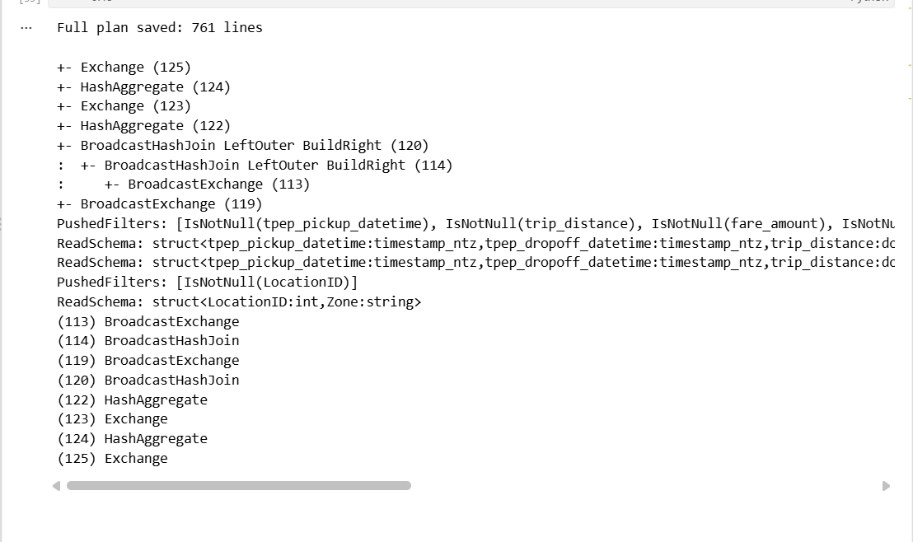

Spark UI plan visualization: 36 Parquet scan branches → union → two broadcast joins → aggregation:

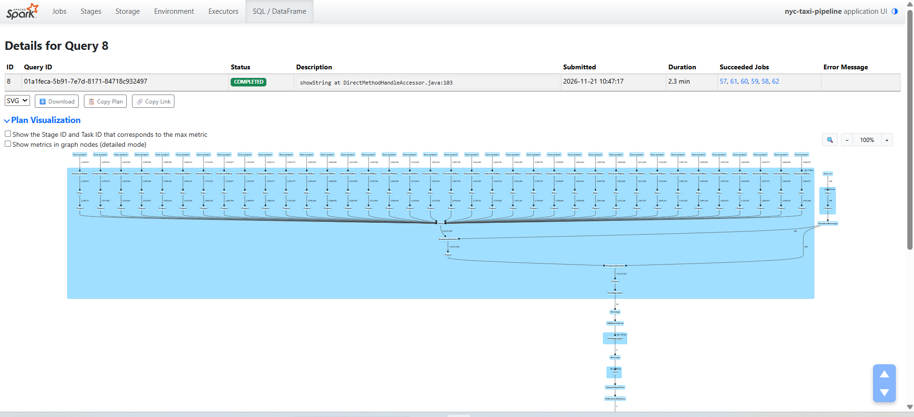

### Query Details view showing optimization
**Filters on each Parquet scan** (Jan 2022: 2,463,931 rows scanned → 2,408,771 after the filter):
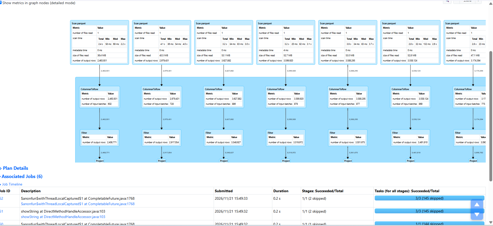

**Broadcast join** – the 265-row zone lookup is broadcast; the 115M-row table is not shuffled:
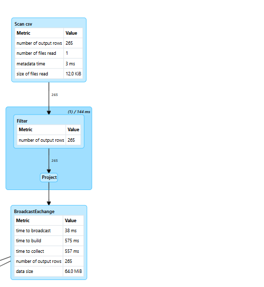
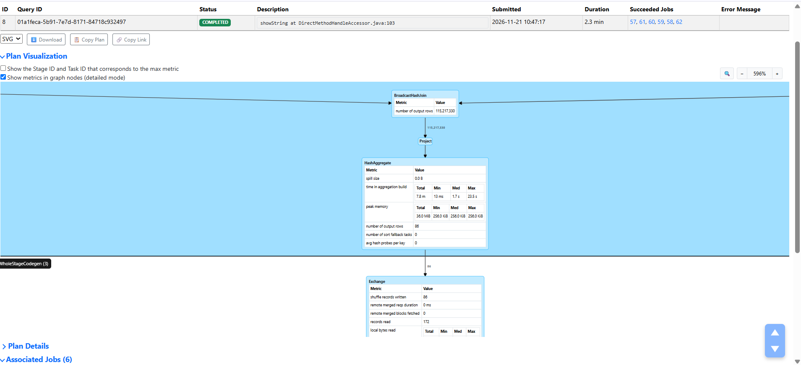

**Partial aggregation** – the only shuffle moves 86 records (7.1 KiB), 16 partitions, 0 B spill:
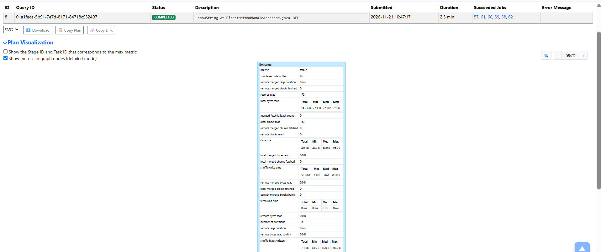

**Final aggregation:**
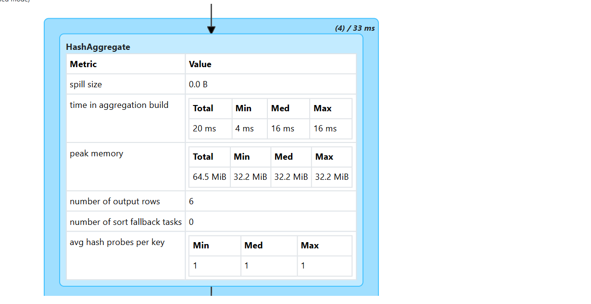
*The metric shows 6 rows because this query ran the final aggregation twice (filling the cache + `show()`);
each run produced 3 rows (2022, 2023, 2024).*

### Successful pipeline execution
All SQL executions in the Spark UI (the 2 failed entries are jobs that were intentionally cancelled while
testing the full-dataset cache and the large write):
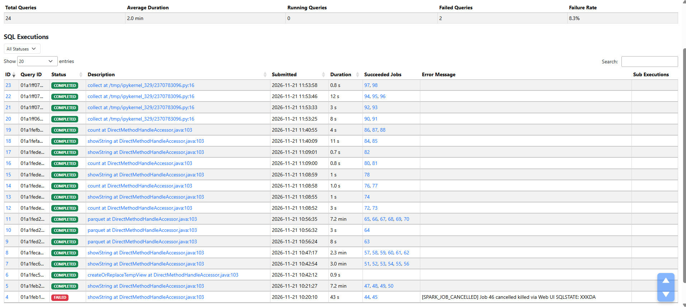

Results written to Parquet and read back (1 file per table):
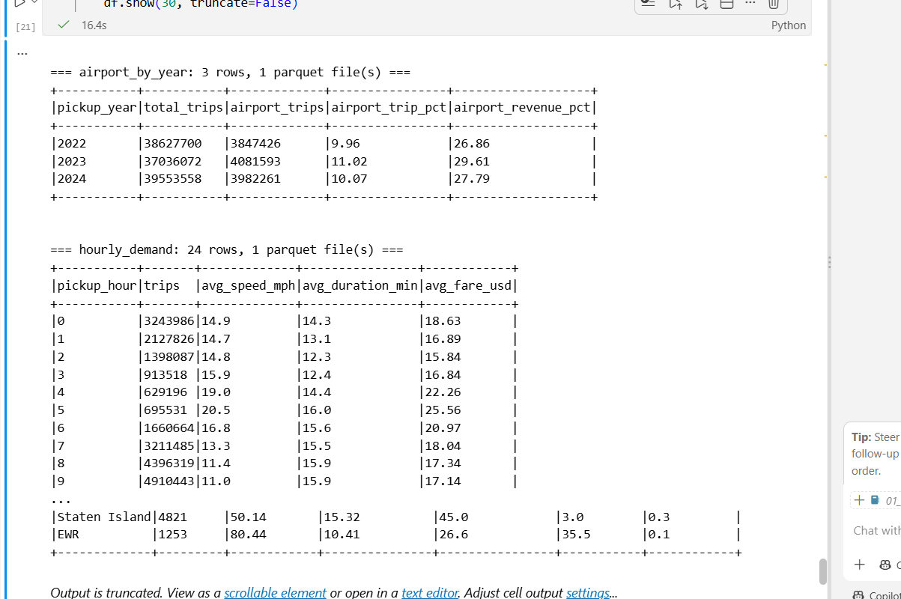
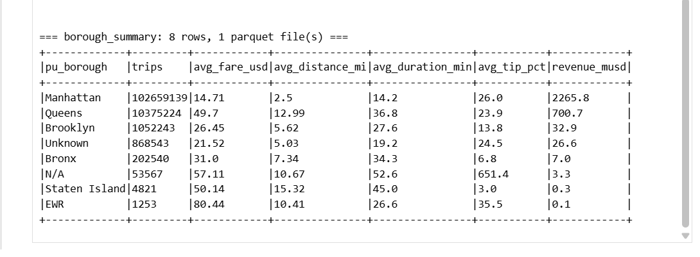

### Caching optimization
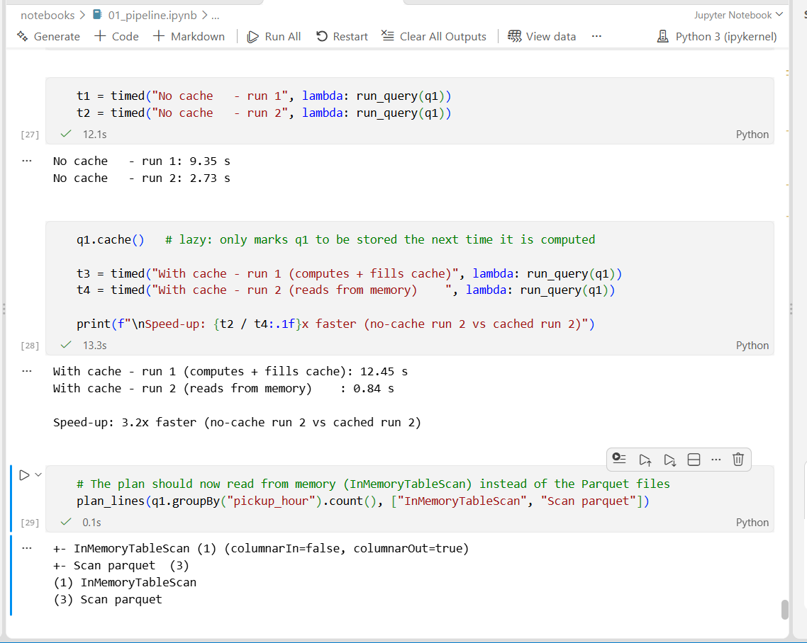
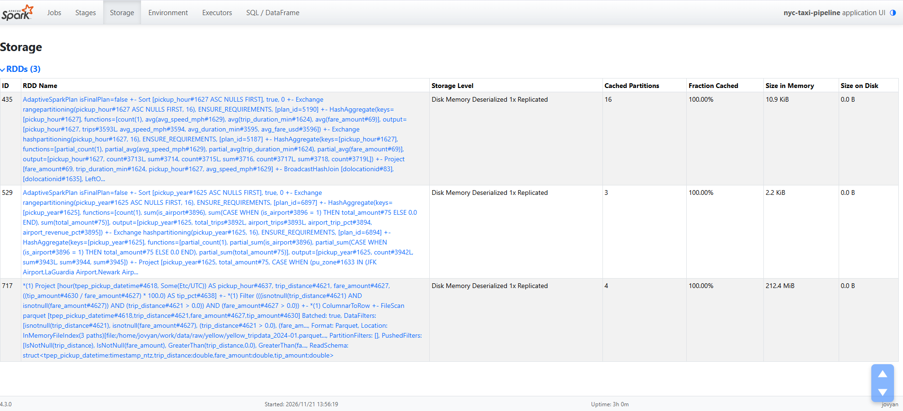
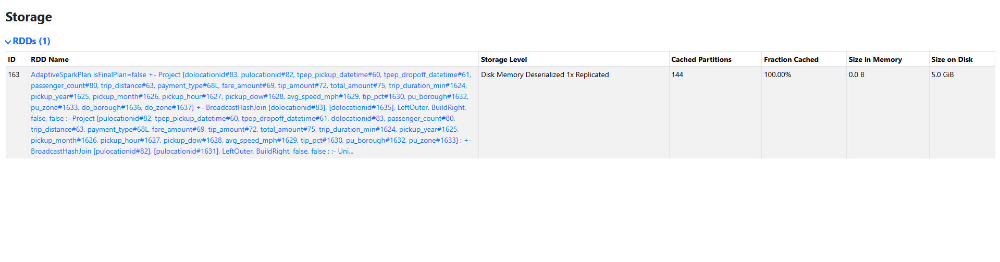

### Actions vs. transformations
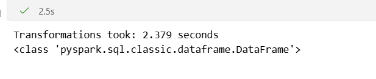
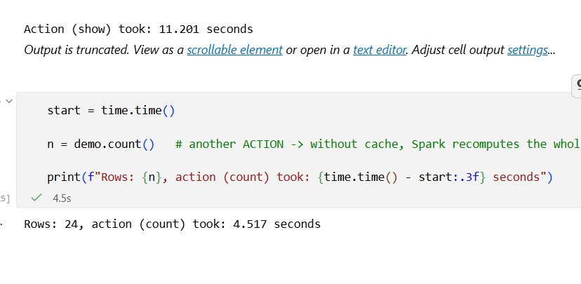

**Spark UI after the transformations** – still 82 completed jobs (the last one is only the schema read):

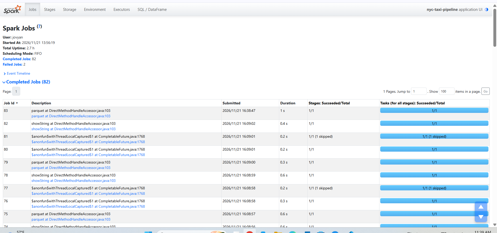

**After `show()`** – 84 completed jobs (+2):

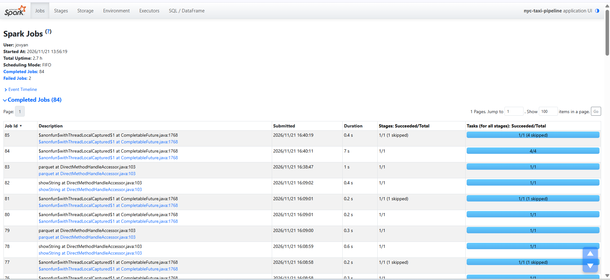

**After `count()`** – 87 completed jobs (+3), the source file is read again (4/4 tasks):

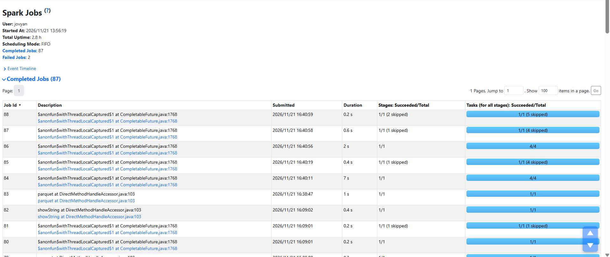

---

## 6. How to Run

Requirements: Docker Desktop (≥ 8 GB memory for WSL2/Docker recommended).

```bash
docker compose up -d                                        # start Spark + Jupyter
docker exec -it spark-taxi python scripts/download_data.py  # download 2022–2024 data (~1.8 GB)
```

Open `notebooks/01_pipeline.ipynb` in Jupyter (`http://localhost:8888/?token=spark`) or VS Code
(kernel → Existing Jupyter Server) and run the cells in order. Spark UI: `http://localhost:4040`.

## 7. Repository Structure

```
├── README.md
├── docker-compose.yml
├── scripts/download_data.py
├── notebooks/
│   ├── 01_pipeline.ipynb
│   └── 01_pipeline.html
├── output/
│   ├── results/      # aggregated results (Parquet)
│   └── plans/        # full physical plan (text)
└── screenshots/
```
